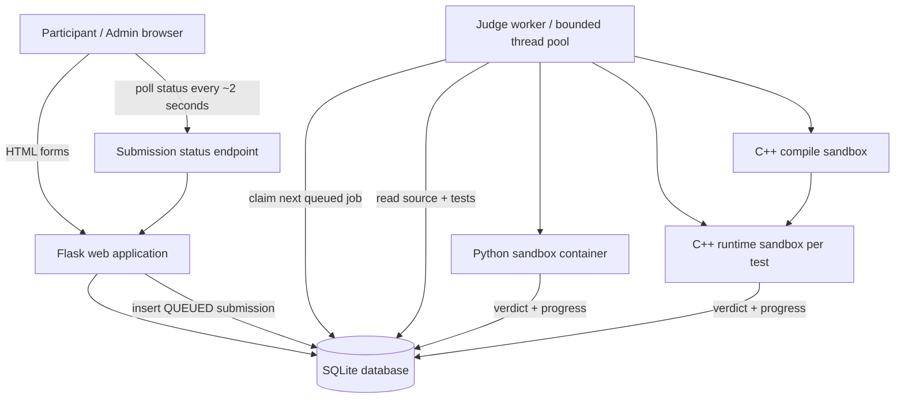
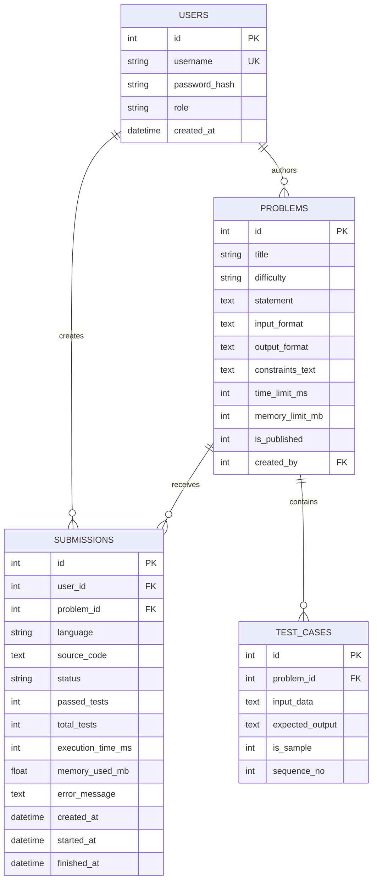

# Architecture and evaluation notes

## 1. Scope, users, and boundaries

**Selected variant:** practice platform.

**Admin/faculty** can sign in and publish a problem with a title, statement, input/output formats, constraints, difficulty, time and memory limits, a public sample, and private test cases. **Participants** can register, browse/search problems, select Python 3 or C++17, submit solutions, see live progress and verdicts, inspect their source snapshots/history, and view the leaderboard.

Out of scope for this MVP: timed contests, per-test partial score, plagiarism detection, collaborative editing, and a production-grade multi-tenant isolation boundary.

## 2. System layout

The web request handler only validates and stores a submission. A separate worker claims the queue and executes code. This prevents submitted code from running inside a Flask request process and lets the web app respond quickly even during bursts.

## 3. Data model

`memory_used_mb` is reserved in the schema for a future telemetry implementation; the current worker enforces the configured memory cap but does not collect peak-memory measurements. `execution_time_ms` currently records judge wall time, including container startup overhead.

## 4. Verdict and comparison rules

1. Python is syntax-checked in a sandbox before tests run. C++17 is compiled in a separate constrained sandbox. A compile failure returns **CE**.
2. Tests run in order: public sample first, then hidden cases. Each execution uses a fresh runtime container.
3. The worker passes only the current test input through stdin. The test suite is never mounted into the execution container.
4. Expected and actual outputs are split into whitespace-delimited tokens. This ignores spaces/newlines but not token values or order.
5. The worker stops on the first failing test: nonzero exit → **RE**; timeout → **TLE**; token mismatch → **WA**; all tests passed → **AC**. Output above the cap → **RE**. A failing compilation → **CE**.
6. The database is updated as each test passes, so the submission detail page can display live progress. Terminal verdicts are persisted with a completion timestamp and a user-safe feedback message.

## 5. Burst handling: 20 submissions at once

The web app inserts each submission into SQLite with `QUEUED` and responds without waiting for execution. The single worker process atomically claims queue entries and runs a bounded number of sandbox jobs concurrently. `JUDGE_WORKERS=2` is the default; set it from 1 to 4 to match available host capacity. With 20 new submissions and the default setting, two execute at once and the remaining 18 wait in the queue. The browser polls the status endpoint and sees `QUEUED`, `RUNNING`, per-test progress, and the final verdict.

The queue is intentionally simple and SQLite-backed for a laptop/classroom demo. Only one worker process should be started, because startup recovery requeues rows left `RUNNING` by an earlier worker. For larger deployments, use a durable external queue and multiple workers with explicit leases/heartbeats.

## 6. Isolation controls

Runtime containers use `--network none`, a read-only root filesystem, non-root UID, dropped Linux capabilities, `no-new-privileges`, constrained CPU/memory/swap/PIDs/file descriptors, a small temporary filesystem, per-test timeout, and output caps. The worker tries to force-remove a container after timeout/output overflow. The web server and worker are separate processes, and no Docker socket is mounted inside the submitted-code container.

These are defense-in-depth controls, not a proof against container escapes: Docker shares the host kernel. The system is intended for a local course demo and not open public submissions from adversaries. Production use should move execution to a hardened dedicated service or microVM/gVisor environment and add quotas, rate limits, TLS, monitoring, and incident response.
